# 议题一：突破 AGY 自动上下文压缩容量上限（从失败复盘到突破落地）

## 一、 问题背景与原始诉求

Google Antigravity CLI (`agy.exe`) 基于 Go 语言编写，内置了基于 Token 水位的自动上下文压缩机制（Checkpointer）。在长会话运行中，当上下文 Token 达到默认水位（出厂默认硬编码为 256,000 Tokens，叠加 15% 内部缓冲区约 289k~294k）时，系统会在后台静默向模型发起会话摘要请求，将活体上下文压扁回初始状态（约 20k~30k），导致早期代码上下文、长篇规范或关键历史被移出活跃窗口。

在大型代码库重构、深度逆向分析与自动化测试等复杂任务中，256k 的上下文容量很快就会被填满，开发者迫切需要将上下文容量真实、平稳地解锁至 512k 甚至 1M，且杜绝任何虚假分母或静默丢历史。

---

## 二、 历史探索与五大陷阱复盘（为什么早期尝试全部触礁？）

在 2026 年 10 月中旬的早期攻坚中，我们曾陷入“按下葫芦浮起瓢”的点状汇编打地鼠泥潭，遭遇了包括**“270k + 100k = 255.2k”**在内的多次滑铁卢。系统性复盘如下：

### 1. 陷阱一：外部生命周期钩子（`hooks.json`）完全无感
- **尝试**：在 `PreToolUse` 或生命周期脚本中尝试拦截压缩事件。
- **逆向实证**：自动压缩根本不是 ToolCall 工具调用，而是注册在 Cortex 调度引擎内部的闭包钩子：
  - `google3/third_party/jetski/cortex/executors/posthooks.NewCheckpointHook.func1`
  - `google3/third_party/jetski/cortex/executors/prehooks.NewCheckpointHook.func1`
- **结论**：每个交互回合由 Go 运行时闭包内部直接驱动，外部任何生命周期 Hook 既无法感知更无法拦截。

### 2. 陷阱二：官方环境变量 `AGY_CLI_AUTO_COMPACT_OVERRIDE` 货不对板
- **尝试**：将环境变量设置为 `2000000000`（20 亿 Tokens）。
- **逆向实证**：汇编追踪表明，该环境变量仅服务于 `jetski/cli/store` 模块，专门控制用户在终端手动敲击 `/compact` 命令时的阈值判定；而后台自动压缩由独立的 `cortex/checkpoint` 决策模块控制，根本不读取该环境变量。

### 3. 陷阱三：配置项 `"contextWindow": "900K"` 制造“皇帝的新衣”
- **尝试**：在 `settings.json` 中配置 `"contextWindow": "900K"`。
- **逆向实证**：该参数仅用于前端 Webview / 终端渲染 UI 时的分母展示（如计算百分比条）；底层执行引擎在组装实际 API 请求时，依然读取硬编码模板中的 `256,000` 限制，达到 256k 附近依然照常压缩。

### 4. 陷阱四：直接二进制打桩置 `enabled: false` 触发死循环风暴
- **尝试**：强行将 15 组 Checkpoint 模板的 `enabled` 设为 `false`。
- **灾难性后果**：终端陷入死循环：**反复打印 `conversation compaction` 分隔符，并死循环重试输出上一句未完成的回答，上下文彻底锁死**。
- **底层成因**：
  1. 下游请求转换层 `TrajectoryChatConverter` 内部包含布尔字段 `ErrorOnTruncationWithoutCheckpoint`；
  2. 当上下文达到 256k 预算上限后，转换器准备裁减早期消息，但发现会话没有任何历史 Checkpoint 锚点；
  3. `ErrorOnTruncationWithoutCheckpoint` 严格抛错：`"no messages fit the executor budget"`；
  4. 上层执行器收到错误后判定必须紧急执行压缩，打印提示并调用 Checkpointer；
  5. Checkpointer 已被置为 `false` 拒绝生成 Checkpoint，导致错误无法消除，触发重试；
  6. 重试再次调用转换器，再次抛错，形成死循环死锁。

### 5. 陷阱五：粗暴短路 `checkpointNeeded` 导致静默削头（FIFO 丢历史）
- **尝试**：将 `checkpointNeeded` 直接 `ret 0` 强行短路，同时将 `GetErrorOnTruncationWithoutCheckpoint` 改为 `return 0` 静音报错。
- **致命后果**：系统在超出 256k 预算且无法生成 Checkpoint 时，由于报警被静音，顺理成章地执行了**静默滑动窗口淘汰（Sliding Window FIFO）**，将 `start step index` 悄悄往后推，最开始的 Step 0、Step 1 历史连同核心代码被无声丢弃，上下文被死锁在 255.2k（`270k + 100k = 255.2k` 惨剧）。

---

## 三、 突破口解构与核心机制逆向

2026 年 11 月，通过解构社区方案突破口（`TheAutomatic/antigravity-context-autofix` 与 `lmxxf/antigravity-context-fix`），并结合我们对 `agy.exe` 的 PE/Go 符号表深度逆向，找到了真正优雅且稳健的底层突破口：

```mermaid
flowchart TD
    subgraph S1["出厂原版链路 (硬编码 256k)"]
        A1["模型参数初始化"] --> B1["applyFeatureProviderCheckpointOverrideConfig"]
        B1 -->|硬编码立即数| C1["max_token_limit = 256,000"]
        C1 --> D1["hooks.checkpointNeeded (判定阈值 = 256,000)"]
    end

    subgraph S2["跳板劫持链路 (动态扩容至 512k+)"]
        A2["模型参数初始化"] --> B2["applyFeatureProviderCheckpointOverrideConfig"]
        B2 -->|末尾替换为 jmp| E2["SetSessionSummaryPromptOverride + 0x20<br>【通用注入跳板】"]
        E2 -->|物理改写结构体| C2["max_token_limit = 512,000 / 734,000 / 983,040"]
        C2 --> D2["hooks.checkpointNeeded (判定阈值推迟至 512k+)"]
    end
```



### 1. 核心突破口：最终出口函数 `applyFeatureProviderCheckpointOverrideConfig`
在 Go 编译的代码中，无论是默认模板还是云端下发的动态配置，最终决定模型单轮回合 Context Window 与 Executor Budget 的最终出口函数恒定为：
`google3/third_party/jetski/cortex/executors/cascade.applyFeatureProviderCheckpointOverrideConfig`

在此函数内部，配置结构体指针被最终处理，其偏移 `+0x0C`（Windows PE64）正是 `max_token_limit` 字段。出厂时硬编码为 `0x0003E800`（`256,000`）。

### 2. 借尸还魂：借用未引用的 Setter 空间
为了避免修改指令导致原有代码段膨胀或破坏 Go 的连续栈检查（`runtime.morestack`），方案借用了同编译单元内一个**未被任何业务逻辑引用的空闲 Setter 函数**：
`google3/third_party/jetski/cortex_pb/cortex_go_proto.(*CheckpointConfig).SetSessionSummaryPromptOverride`

- **空间充裕**：该函数体出厂占用了 100+ 字节，但生产运行时根本未被调用；
- **入口打桩**：将函数入口 patch 为 `31 c0 31 db 31 c9 c3`（`xor eax, eax; xor ebx, ebx; xor ecx, ecx; ret`），保证万一被调用时也能安全返回，不破坏 ABI；
- **跳板驻留**：在函数偏移 `+0x20` 的充裕空间内植入通用注入跳板（Universal Trampoline）。

### 3. 保留安全气囊：绝不破坏 `checkpointNeeded`
本方案**完全不改动 `hooks.checkpointNeeded` 的判定逻辑与跳转**！
- 原生状态机依然健康运转；
- 当物理累积到达 512k 真实水位时，Checkpointer 依然能够被正常唤醒，绝不会发生由于静音报警引发的“静默削头丢历史”；
- 仅仅是将触发自动压缩的水位门槛推迟到了 512k / 734k / 983k。

---

## 四、 方案设计与汇编机器码细节

### 1. 出口跳转（`applyFeatureProviderCheckpointOverrideConfig`）
在出口函数末尾，将出厂写入指令单条替换为相对跳转指令 `jmp`：

- **出厂机器码**：
  `48 89 42 10 48 89 d0 31 db`
  (`mov [rdx+0x10], rax; mov rax, rdx; xor ebx, ebx`)
- **补丁后机器码**：
  `e9 <rel32> 90 48 89 d0`
  (`jmp trampoline; nop; mov rax, rdx`)

### 2. 通用跳板逻辑（Trampoline Payload）
跳板位于 `SetSessionSummaryPromptOverride + 0x20`，汇编逻辑如下：

```nasm
test   rax, rax             ; 检查模型配置指针是否为空
jz     exit                 ; 空指针直接跳出保护
mov    rcx, [rdx+0x08]      ; 读取上级上下文结构体指针
test   rcx, rcx             ; 校验指针有效性
jz     exit                 ; 
mov    ecx, [rax+0x0c]      ; 读取当前 max_token_limit
cmp    ecx, 0x0003e800      ; 检查是否为出厂默认的 256,000 (0x3E800)
jne    exit                 ; 若已经被外部更高参数覆盖，则不破坏
nop                         ; 
mov    dword ptr [rax+0x0c], <TARGET_BUDGET> ; 写入新上限 (如 512,000 = 0x7D000)
mov    [rdx+0x10], rax      ; 恢复被替换的原指令
xor    ebx, ebx             ; 恢复被替换的原指令
jmp    <BACK_TO_CALLER>     ; 跳回原函数继续正常执行
```

### 3. 三档容量预算设计

| 档位 | 标称容量 | 实际 Token 数 (HEX) | 适用场景与评估 |
|:---:|:---:|:---:|:---|
| **Tier 1 (推荐档)** | **512K** | `512,000` (`0x0007D000`) | **最稳定、平衡的推荐档位**。完美匹配绝大多数项目长上下文需求，TPU KV Cache 命中率高，延迟低。 |
| **Tier 2 (高容量档)** | **734K** | `734,000` (`0x000B3340`) | 适用于超大型多文件深度审查或巨型调用链排查。 |
| **Tier 3 (极限档)** | **983K** | `983,040` (`0x000F0000`) | 接近 1M 物理极限（0x100000 边界下保留安全冗余）。会话极长时服务端首字延迟可能上升。 |

---

## 五、 Windows 工程落地：免停机原子热替换机制

在 Windows 操作系统下，落地可执行文件替换存在严苛的底层文件锁限制：

### 1. Windows NTFS 文件锁冲突
- 当 Antigravity CLI 或其守护进程正在运行时，Windows 内存管理器会将 `.exe` 镜像映射入虚拟内存（`IMAGE_FILE_EXECUTABLE_IMAGE`）；
- 此时使用常规的 `open("r+b")` 写入或 `os.replace()` 覆写，内核会直接抛出：
  `PermissionError: [WinError 5] 拒绝访问 / [WinError 32] 进程无法访问`。

### 2. 两步原子重命名原理
Windows NTFS 具备一个关键特性：**运行中的可执行文件禁止覆写与删除，但允许在同分区内被重命名（Rename）**！

我们在 [`scripts/patch-context.py`](file:///F:/Git/tool-dev/Ducheese/antigravity-restrictions-bypass/scripts/patch-context.py) 中实现了 Windows 专属的两步原子热替换：
1. **第一步（重命名避让）**：将当前正在运行的 `agy.exe` 原子重命名为 `agy.exe.<timestamp>.old`；
   - 此时旧进程的内存映射保持不受任何损害，当前会话进程零中断、零崩溃；
   - 原路径 `C:\Users\alord\AppData\Local\agy\bin\agy.exe` 的目录项被立刻释放；
2. **第二步（移入新文件）**：将修补完毕的新文件原子重命名为 `agy.exe`；
3. **第三步（旧文件回收）**：当旧会话退出关闭句柄后，或下一次运行脚本时，自动检测并删除历史残留的 `.old` 文件。

---

## 六、 生产环境全量修补与数据实证

### 1. 单脚本三合一体系与规则解耦能力
`scripts/patch-context.py` 原生将【上下文扩容】与【规则门禁放宽】合二为一（基于 Go pclntab 动态符号解析，单脚本同时完成 512K/734K/983K 上下文跳板注入与 1MB 规则文件/131K 规则预算放宽）。
若仅需要提升上下文容量而保持官方规则门禁不变，可传入 `--skip-rules` 参数实现独立解耦控制：
- **默认全量模式**：`python scripts/patch-context.py --tier 1 -y`，一键完成 512K 上下文与 1MB/131K 规则放宽；
- **解耦独立模式**：`python scripts/patch-context.py --tier 1 --skip-rules -y`，仅打入上下文跳板，不触碰规则逻辑。

### 2. 真实生产环境（v1.5.3）SQLite 数据实证
打入补丁重启 Antigravity 后，真实请求发往 Gemini 时，会话数据库（`gen_metadata`）记录下不可辩驳的底层数据：

```json
{
  "read_mode": "read_only",
  "conversation_id": "cf174d3c-df45-461e-a2cc-b899402447d4",
  "latest_turn": {
    "gen_idx": 5924,
    "gen_max_context_tokens": 512000,
    "gen_used_tokens": 164931,
    "gen_usage_percent": 32.2,
    "model_name": "gemini-3.8-flash-n"
  }
}
```

```
Usage : █████░░░░░░░░░░░  162,917 / 512,000 tokens (31.8%)
```

- **分母从 256,000 跃升为 512,000**；
- 证实发送至 Google 云端的真实网络请求参数已物理生效；
- 宣告 Antigravity 上下文容量突破议题正式攻坚成功并全面投产。
